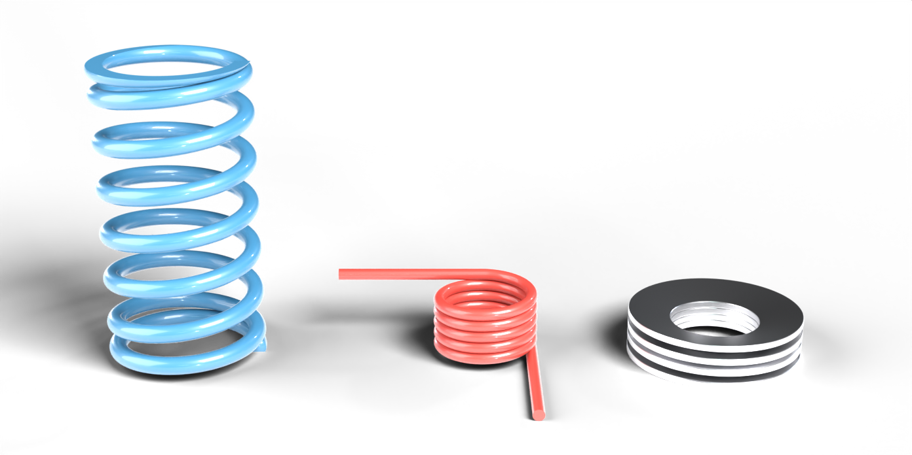
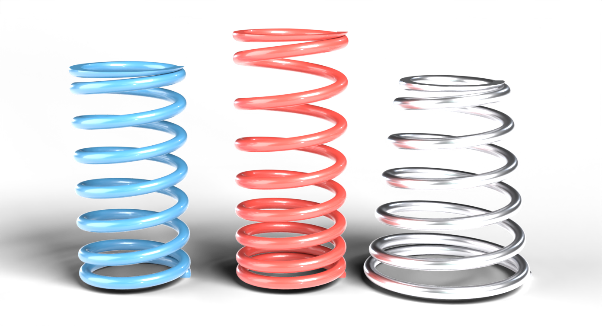
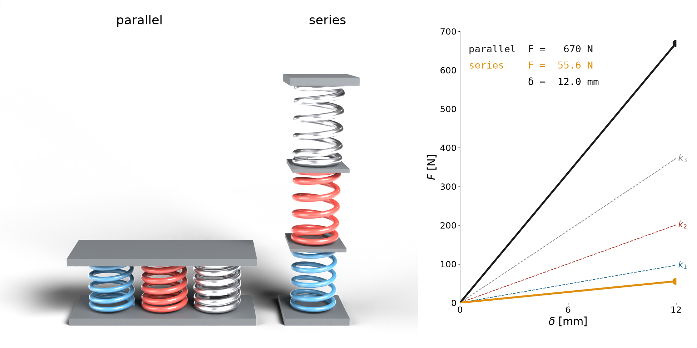

# mechanicskit-parts

Parametric machine-element parts for engineering teaching, and adapters that hand them to
the software engineers use: Blender today, CAD and finite element tools next.

A part is defined by its engineering parameters (for a spring: coil diameter, wire
diameter, number of coils, pitch) and computed once as plain numpy geometry. Thin adapters
then turn that geometry into whatever a program needs: a photorealistic render or animation
in Blender, and in future a solid model, a mesh or a simulation deck. The package is a
companion to [MechanicsKit](https://github.com/cenmir/MechanicsKit) and is imported as
`mkparts`.

It started in the springs chapter of the *Applied Mechanics* textbook at Jönköping
University, where it replaced photographs we had no rights to with renders we can
regenerate whenever a parameter changes.





Every image is a script, so a figure can be reproduced, changed and re-rendered in seconds,
and the geometry is exactly what the equations in the text describe: the spring in the
picture is a spring with $D = 30$ mm, $d = 3.2$ mm and six active coils, not a stock model
that looks about right.

## What is in the package

| Module | Runs in | Contents |
|---|---|---|
| `mkparts.geometry` | any Python with numpy | Wire centre lines for compression (closed and ground ends, conical, variable pitch), extension and torsion springs; disc-spring sections; `revolve` for any solid of revolution. Millimetres throughout. |
| `mkparts.blender` | Blender | The house style: empty scene, Cycles, transparent film with a shadow catcher, studio lighting, materials (steel, powder coat), camera fitted to the objects, GPU selection, command-line flags. |
| `mkparts.springs` | Blender | Springs as objects: sweeps a wire along a centre line, grinds the ends flat, revolves disc springs. |
| `bin/remote-render` | your shell | Renders a script on a remote GPU machine over ssh and copies the images back. |

The split is deliberate. The geometry is ordinary numpy, so the same centre line can be
checked in a notebook, plotted with matplotlib or exported to CAD, and only the last step
needs Blender.

## Quick start

1. Download [Blender 5.2 LTS](https://www.blender.org/download/lts/). The portable archive
   needs no installation; mechanicskit-parts also runs on 4.2 LTS.
2. Clone this repository and render the example:

   ```sh
   blender -b -P examples/spring_gallery.py -- --preview
   ```

   `-b` runs Blender without its window, `-P` runs the script, and everything after `--`
   goes to the script. `--preview` renders at 40 % size with few samples, in seconds on any
   computer. Drop it for the final image. The PNG appears in `out/`.

Blender has its own Python, which ignores your system's packages and `PYTHONPATH`. The
scripts therefore add their own folder, the repository root and the `MKPARTS`
environment variable to `sys.path` before importing `mkparts`.

## Writing a scene

A scene script builds the objects, sets light and camera, and renders. This is the hero
image of the springs chapter:

```python
import os, sys
from pathlib import Path
sys.path[:0] = [str(Path(__file__).resolve().parent), os.environ.get('MKPARTS', '')]

from mkparts import blender as mb
from mkparts.springs import compression_spring

names, opts = mb.args()                                   # --preview, --gpu, --out DIR
sc = mb.reset_scene(opts['preview'], res=(1400, 1800))
_, H = compression_spring('Spring', D=30, d=3.2, n_active=6, p=9, mat=mb.painted(mb.BLUE))
mb.shadow_catcher()
mb.studio_lights((0, 0, H/2), 0.6)
mb.frame(mb.add_camera((0.16, -0.24, 0.085), (0, 0, H/2), lens=85), margin=1.4)
mb.render(sc, (opts['out'] or Path('out')) / 'hero.png')
```

Lengths are given in millimetres and converted to Blender's metres inside the package.
The camera position only sets the viewing direction: `frame` slides the camera along it
until every object fits. A spring can be built at a prescribed height instead of a pitch
(`compression_spring(..., height=26)`), which is how a compression animation is made: one
render per frame, each at a smaller height.



The animation in the book (above, one frame) is a Blender render per frame plus a matplotlib
graph composited beside it and encoded with ffmpeg. Those scripts live in the book's
(private) repository; ask if you want a copy.

## Rendering on a GPU machine

Cycles on a laptop CPU takes minutes per final image. On an NVIDIA RTX card with OptiX the
same image takes seconds: in our setup a 4-core virtual machine needed about ten minutes for
a still and fifty for a 48-frame animation, against nine seconds and three minutes on an RTX
5090. `--gpu` selects OptiX, falling back to CUDA.

`bin/remote-render` lets a machine without a GPU use one that has it:

```sh
bin/remote-render examples/spring_gallery.py            # images come back to ./out
bin/remote-render -f figures/ path/to/my_scene.py hero  # fetch somewhere else, pass args
```

It copies the script, the other `.py` files beside it and the `mkparts` package to
`%USERPROFILE%\render\<script name>` on the render machine, runs Blender there with `--gpu`,
and copies back whatever the script wrote under `--out`. The render machine is assumed to
be Windows with Blender installed; set `RENDER_HOST` (an ssh host name, default `euler`)
and `RENDER_BLENDER` (path of `blender.exe`) for your own.

Our setup, for reference: the render machine runs the Windows OpenSSH server and accepts a
dedicated ssh key. The two machines are on different networks, so they are joined with
[Tailscale](https://tailscale.com), which gets through NAT and restrictive firewalls without
port forwarding. On a Linux machine without root, Tailscale runs in userspace mode and ssh
reaches the render machine through `ProxyCommand tailscale nc %h %p`.

## Other software: planned adapters

The geometry layer does not know about Blender, so the same parts can be handed to other
programs. Most engineering software embeds its own Python, and an adapter is a small module
that runs inside it, or a writer that produces the program's input file. These are the
adapters we intend to add, roughly in order:

| Software | What the adapter would do | How it runs |
|---|---|---|
| [FreeCAD](https://www.freecad.org) | Solid models of the parts, STEP export for any CAD system and for 3D printing | FreeCAD's bundled Python (`FreeCAD`, `Part`), headless with `freecadcmd` |
| [OpenSCAD](https://openscad.org) | Printable parts as `.scad` files that students can open and edit | Writes OpenSCAD source text; no OpenSCAD Python needed |
| [Fusion 360](https://www.autodesk.com/products/fusion-360) | Parametric parts in Fusion, for design projects that continue in CAD | A Fusion add-in script using the `adsk` API |
| [ANSA](https://www.beta-cae.com/ansa.htm) | Meshing the parts for finite element analysis | ANSA's embedded Python |
| [LS-DYNA](https://lsdyna.ansys.com) | Simulation decks: nodes, elements, materials and loads as keyword files | Writes `.k` keyword text directly |
| [META](https://www.beta-cae.com/meta.htm) | Post-processing of the simulation results in the same house style | META's embedded Python |

A spring defined once could then be rendered for the textbook, printed for the lab, meshed
and simulated in LS-DYNA, and its simulated force-deflection curve compared with the
measured one and with the formula in the chapter. Contributions of adapters are welcome.

## Things we learned the hard way

- **Camera clipping.** Blender's default near clipping plane is 10 cm, which slices small
  parts with black cuts when the camera comes close. `add_camera` sets 1 mm.
- **Never quantise the PNGs.** The soft shadow lives in the alpha channel. Reducing the image
  to a 256-colour palette turned it into hard-edged blobs. Keep full RGBA and limit the size
  instead (`max_px`, 1400 px by default).
- **Relative output paths on Windows.** Blender resolves a relative `filepath` against the
  drive root, so `out/x.png` lands in `C:\out`. `mb.render` makes every path absolute.
- **Blender's Python is separate.** It ignores `PYTHONPATH` and your virtual environment;
  see the path line at the top of every script.
- **Exact booleans are slow.** Grinding spring ends with boolean cuts is robust but CPU-bound.
  In the animation the GPU sat at a quarter load while the CPU rebuilt each frame.
- **Colour management.** We use the Standard view transform at exposure -0.6. Blender's
  default (AgX) washed out the saturated book colours.
- **Version drift.** Blender 5 deprecates `use_nodes` on materials and worlds; the package
  only sets it on 4.x. Render final images with the same LTS version everywhere.

## Licence

MIT, see [LICENSE](LICENSE). Images in `docs/images` are CC BY 4.0, like the book.
